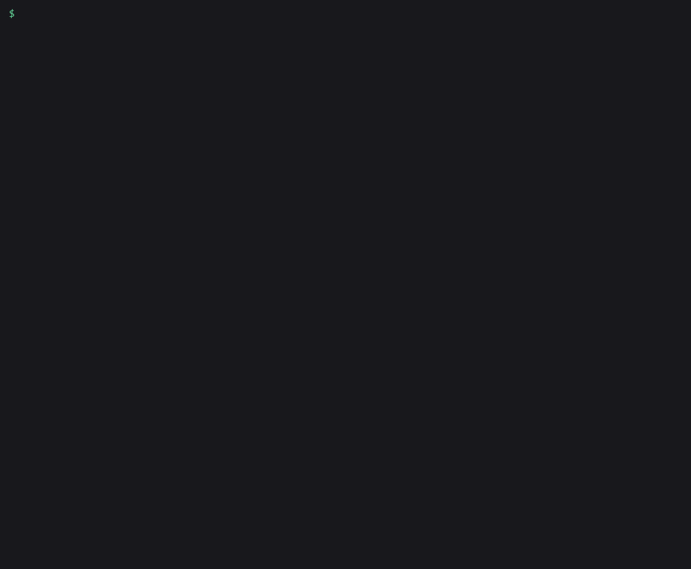

# amagi-crawlers

See which AI crawlers can reach your sites, and catch the firewall that blocks a bot your
robots.txt lets in.

Give it a list of domains. For each one it reads robots.txt the way the crawlers do, checks the
page for `noai` and `noindex` opt-outs, notes whether there's an llms.txt, then requests the page
once per bot with that bot's user agent: GPTBot, OAI-SearchBot, ChatGPT-User, ClaudeBot,
PerplexityBot, Perplexity-User, CCBot, Bytespider, Meta-ExternalAgent and more. You get a table
in the terminal, plus a CSV and a markdown grid if you want them.

The row to look for is `CONFLICT`. robots.txt allows the bot, a normal browser gets the page, and
the server answers the bot with a 403 or a challenge page. That's usually a CDN or WAF bot rule
that nobody lined up with robots.txt, and it can keep a site out of ChatGPT search or Perplexity
answers even though the site owner meant to allow them.

It's for site owners, SEO and web agencies, and MSPs who get asked "are we blocking AI or not?"
for more than one site.

## Demo



## Install

```
pipx install amagi-crawlers
```

Requires Python 3.9+. No dependencies outside the standard library.

## Usage

### Try it offline

`--demo` starts three small sample sites on your own machine and checks them, so you can see every
verdict without touching the internet:

```
amagi-crawlers --demo --bots GPTBot,ClaudeBot,PerplexityBot,Perplexity-User,Google-Extended
```

```
shop.example
  robots.txt 200 | llms.txt yes | browser 200
  BOT                USE       ROBOTS.TXT                     HTTP       VERDICT
  GPTBot             training  Disallow: / (own group)        200        BLOCK robots
  ClaudeBot          training  Disallow: / (own group)        200        BLOCK robots
  PerplexityBot      search    Allow: / (*)                   200        ALLOW
  Perplexity-User    user      Allow: / (*)                   200        ALLOW
  Google-Extended    training  Disallow: / (own group)        -          BLOCK robots

news.example
  robots.txt 200 | llms.txt no (HTML page) | browser 200 (Cloudflare)
  BOT                USE       ROBOTS.TXT                     HTTP       VERDICT
  GPTBot             training  allowed (*)                    403        CONFLICT 403
  ClaudeBot          training  allowed (*)                    403        CONFLICT 403
  PerplexityBot      search    allowed (*)                    403        CONFLICT 403
  Perplexity-User    user      allowed (*)                    challenge  CONFLICT challenge
  Google-Extended    training  allowed (*)                    -          ALLOW

blog.example
  robots.txt 404 (no robots.txt) | llms.txt no (404) | browser 200 | tdm-reservation 1
  BOT                USE       ROBOTS.TXT                     HTTP       VERDICT
  GPTBot             training  no robots.txt                  200        ALLOW noai/noimageai/noindex
  ClaudeBot          training  no robots.txt                  200        ALLOW noai/noimageai
  PerplexityBot      search    no robots.txt                  200        ALLOW noai/noimageai
  Perplexity-User    user      no robots.txt                  200        ALLOW noai/noimageai
  Google-Extended    training  no robots.txt                  -          ALLOW noai/noimageai

3 sites, 15 bot checks: 8 allowed, 3 blocked by robots.txt, 4 refused by the server, 4 conflicts.
Conflicts (robots.txt allows the bot, the server refuses it):
  news.example             GPTBot             browser gets 200, this bot gets 403 (Cloudflare)
  news.example             ClaudeBot          browser gets 200, this bot gets 403 (Cloudflare)
  news.example             PerplexityBot      browser gets 200, this bot gets 403 (Cloudflare)
  news.example             Perplexity-User    browser gets 200, this bot gets challenge (Cloudflare)
```

The shop keeps training crawlers out and lets AI search in, which is a common deliberate policy.
The news site's robots.txt invites everyone, but its firewall turns four AI user agents away. The
blog has no robots.txt at all and opts out page by page with a `noai` meta tag. The exit code is 1
because there are conflicts.

### On real sites

```
amagi-crawlers example.com
amagi-crawlers example.com https://example.org/blog/some-post
amagi-crawlers -f examples/sites.txt -o crawlers.md -o crawlers.csv
```

A bare domain checks `https://<domain>/`. A full URL checks that page. `-f` reads one site per
line from a file, and `#` starts a comment. Each `-o` writes a report, and the extension picks the
format: `.csv`, `.md`, `.json` or `.txt`.

Here is part of a run against four public sites on 2026-10-27, with six bots:

```
amagi-crawlers theguardian.com nytimes.com anthropic.com stackoverflow.com --bots GPTBot,OAI-SearchBot,ClaudeBot,PerplexityBot,Perplexity-User,CCBot
```

```
theguardian.com
  robots.txt 200 | llms.txt no (404) | browser 200
  BOT                USE       ROBOTS.TXT                     HTTP       VERDICT
  GPTBot             training  allowed (*)                    200        ALLOW
  OAI-SearchBot      search    allowed (*)                    200        ALLOW
  ClaudeBot          training  Disallow: / (own group)        403        BLOCK robots+403
  PerplexityBot      search    Disallow: / (own group)        403        BLOCK robots+403
  Perplexity-User    user      allowed (*)                    403        CONFLICT 403
  CCBot              training  Disallow: / (own group)        403        BLOCK robots+403

stackoverflow.com
  robots.txt 418 (unreadable; crawlers treat it as allow all) | llms.txt no (404) | browser challenge (Cloudflare)
  note: the site also blocks a plain browser request from this checker, so a refused bot is UNKNOWN, not a conflict
  BOT                USE       ROBOTS.TXT                     HTTP       VERDICT
  GPTBot             training  robots.txt unreadable (418)    403        UNKNOWN
  OAI-SearchBot      search    robots.txt unreadable (418)    challenge  UNKNOWN
  ...

4 sites, 24 bot checks: 8 allowed, 9 blocked by robots.txt, 4 refused by the server, 1 conflict, 6 unknown.
Conflicts (robots.txt allows the bot, the server refuses it):
  theguardian.com          Perplexity-User    browser gets 200, this bot gets 403
```

The Guardian's robots.txt has no group for Perplexity-User, so the `*` rules allow it, but the
server sends that user agent a 403. On the same run nytimes.com disallowed all six bots in
robots.txt, anthropic.com allowed all six, and Stack Overflow challenged this checker's own browser
request, so its bot results are `UNKNOWN`. The whole run took 11 seconds. Results change as sites
change their rules.

The markdown report starts with one grid, a row per site and a column per bot, with conflicts in
bold. A per-site table with the robots.txt rule, the HTTP answer and a note for each bot follows.
See [examples/demo-report.md](examples/demo-report.md). The CSV has one row per site and bot, for
a spreadsheet or a diff between runs.

### Reading the result

| Verdict | Meaning |
|---|---|
| `ALLOW` | robots.txt allows the bot and the server answers it |
| `ALLOW noai/...` | Allowed, but the page opts out in an `X-Robots-Tag` header or a robots meta tag |
| `BLOCK robots` | robots.txt disallows the bot |
| `BLOCK robots+403` | robots.txt disallows it and the server refuses it as well |
| `CONFLICT 403` / `CONFLICT challenge` | robots.txt allows it, a browser gets through, the bot gets a 403, a challenge page or a dropped connection |
| `UNKNOWN` | robots.txt allows it, but the site blocks this checker's browser request too, so a bot-specific block can't be told apart. A page that returns 404 to the browser also gives `UNKNOWN` |
| `ERROR` | The site could not be reached |

The `USE` column says what the operator uses the bot for: `training` (collecting data for
models), `search` (an AI search index) or `user` (fetching a page because someone asked the
assistant about it). Blocking training while allowing search and user bots keeps a site citable
in AI answers.

Exit codes: `0` no conflicts, `1` at least one conflict, `2` bad input or no site reachable. A
nightly job can alert on exit code 1.

### What it checks

- **robots.txt**, per [RFC 9309](https://www.rfc-editor.org/rfc/rfc9309): a bot follows every
  group that names it, merged, and ignores `*` when it has its own group. The longest matching
  path wins, `Allow` wins a tie, and `*` and `$` work as wildcards. A 404 means allow all. A 5xx,
  a 429 or no answer means disallow all.
- **Page opt-outs**: `X-Robots-Tag` headers, including bot-scoped ones like
  `X-Robots-Tag: GPTBot: noindex`, plus `<meta name="robots">` and per-bot meta tags such as
  `<meta name="GPTBot">`. It reports `noai`, `noimageai`, `noindex` and `none`.
- **The HTTP answer per bot**: one browser request first as a baseline, then one request per bot
  with its user agent. Redirects are followed with the same user agent, so a block on the target
  page is still caught. Challenge pages (Cloudflare, DataDome, Imperva and others) count as a block.
  The CDN or WAF is named when its headers give it away.
- **llms.txt**: present, missing, or a soft 404 (the server returns an HTML page with status 200).
- **TDMRep**: a `tdm-reservation: 1` header or meta tag, which reserves text-and-data-mining
  rights under the W3C TDMRep protocol.

`amagi-crawlers --list-bots` prints the 16 crawlers it knows and the exact user agent it sends for
each. `Google-Extended` and `Applebot-Extended` are robots.txt tokens only. Google and Apple
fetch with Googlebot and Applebot, so those two get a robots.txt verdict and no HTTP check. Any
other name passed to `--bots` gets a robots.txt and meta-tag check.

### More options

```
amagi-crawlers example.com --bots GPTBot,ClaudeBot     # only these bots
amagi-crawlers example.com --path /pricing             # check this page on every site
amagi-crawlers -f sites.txt --format csv > out.csv     # CSV on stdout
amagi-crawlers example.com --no-fetch                  # robots.txt and page tags only
amagi-crawlers -f sites.txt --delay 1 --workers 2      # go slower on shared hosting
amagi-crawlers --list-bots                             # the crawler catalog
```

## Limits

- **It sends the bot's user agent from your IP address.** The real crawlers come from their
  operators' published IP ranges, and some firewalls check that. A site can treat the real GPTBot
  differently from this check, in either direction. A `CONFLICT` means the server refuses that
  user agent string; it says nothing about what the server does for verified bot IPs.
- **Bot managers block scripts.** Cloudflare, DataDome and others often challenge any client that
  isn't a real browser, this one included. Those sites come back `UNKNOWN`. Check the bot settings
  in the CDN dashboard instead.
- **Two user agents are reconstructed.** Anthropic documents the Claude-SearchBot and Claude-User
  tokens but not their full user-agent strings, so the tool builds them in the ClaudeBot pattern.
  `--list-bots` marks these as `pattern`.
- **One page per site.** It checks the home page, or the page you name. A rule that only covers
  `/blog/` won't show up unless you check a blog URL.
- **On Windows**, a first HTTPS request can fail with `CERTIFICATE_VERIFY_FAILED` until Windows
  fetches the site's root certificate. Running it again usually works.
- **It only reads.** It sends a few GET requests per site and changes nothing. Run it on sites you
  manage or have been asked to check.

## Use it with Claude Code

[SKILL.md](SKILL.md) teaches Claude Code when to run the check and how to explain the result,
with conflicts first. Copy it into `~/.claude/skills/amagi-crawlers/`.

## Why not curl?

`curl -A GPTBot` tells you what one bot gets on one page. You still have to read robots.txt by hand
and work out group precedence, compare against a browser request, and repeat for every bot and
every site. A robots.txt tester reads robots.txt and nothing else, so it misses the firewall half.
`amagi-crawlers` does both halves for a whole list, and writes a file you can send to the client.

## If this saved you time

A star on GitHub helps other site owners find it.

## More from AmagiLabs

- [amagi-watch](https://github.com/amagilabs/amagi-watch): turn a video URL into a transcript and
  key-frame index Claude can read.
- [github.com/amagilabs](https://github.com/amagilabs): the rest of the AmagiLabs lab.

## License

MIT, see [LICENSE](LICENSE). Copyright (c) 2026 Amagisolutionsgroup, Inc. (AmagiLabs).
